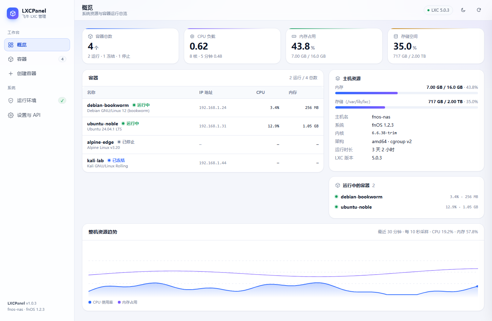
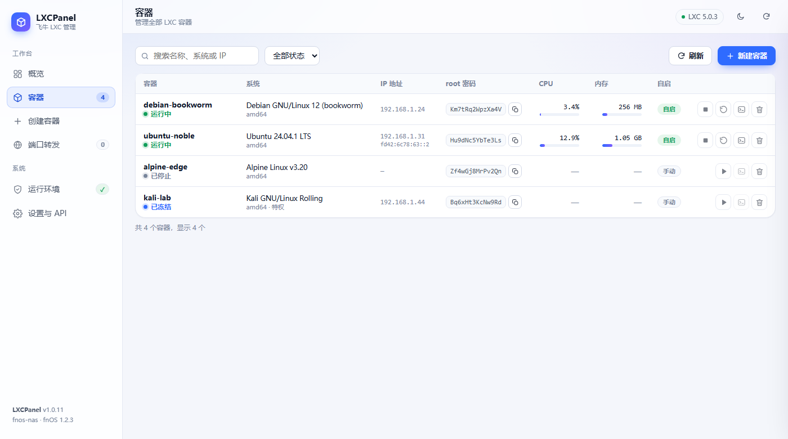
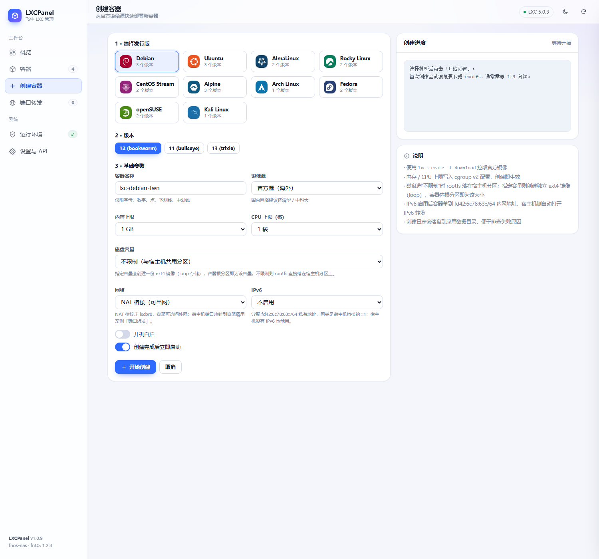
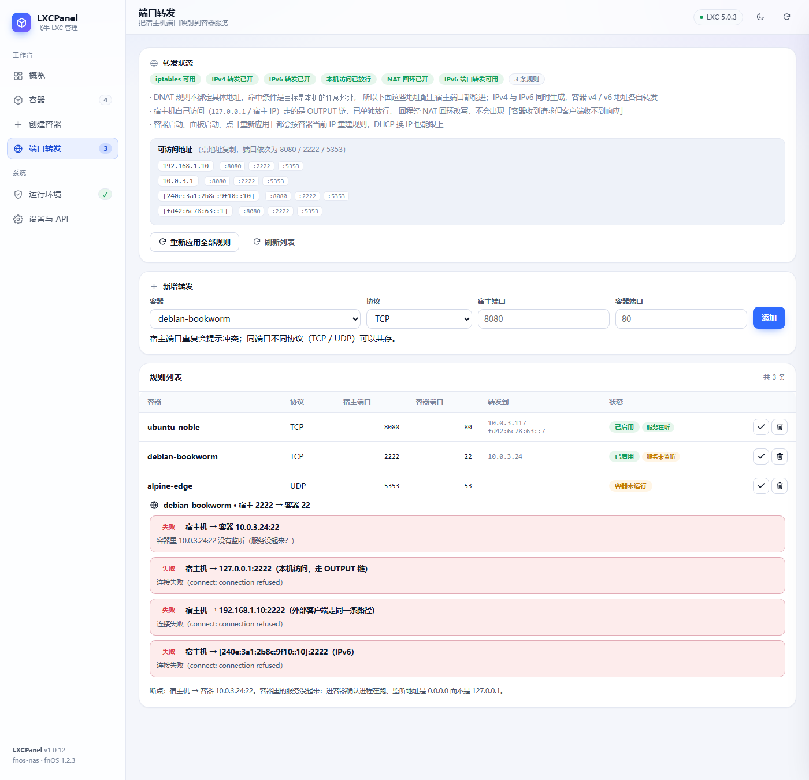
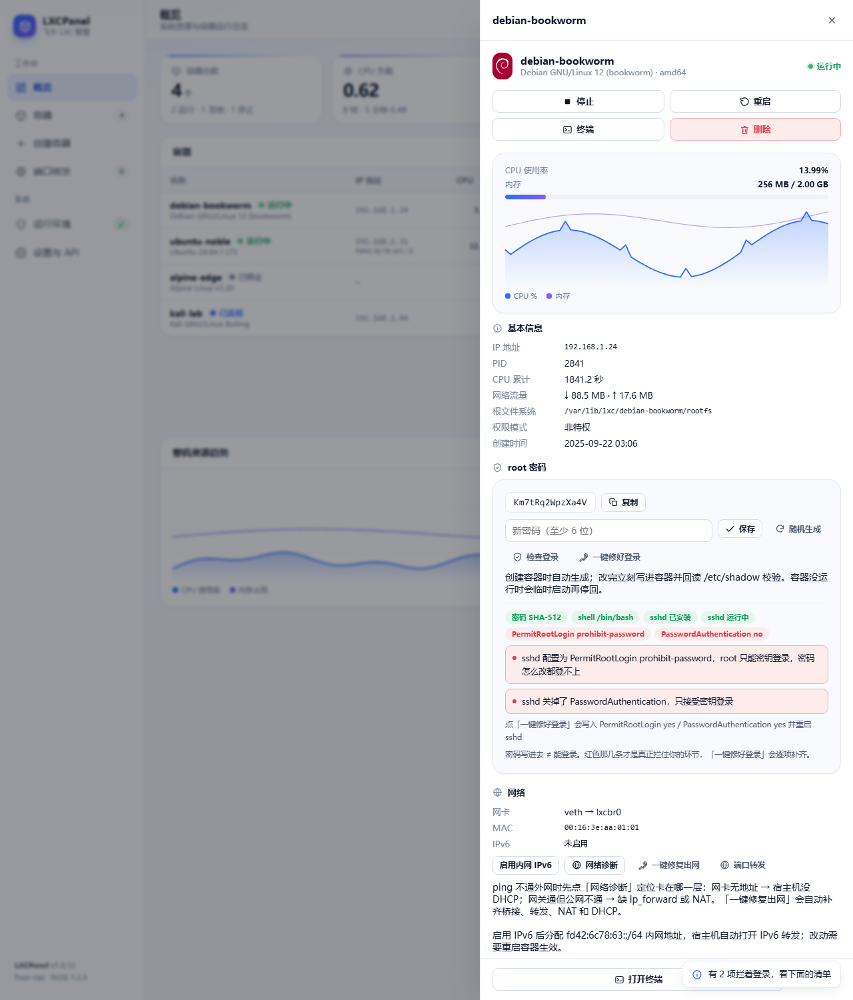
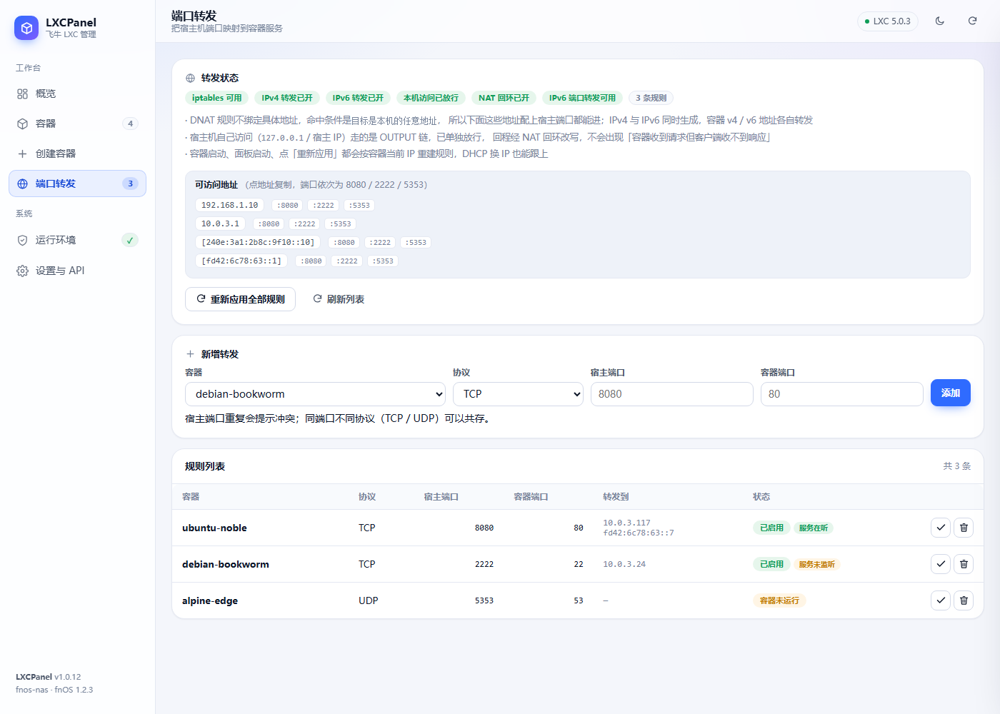
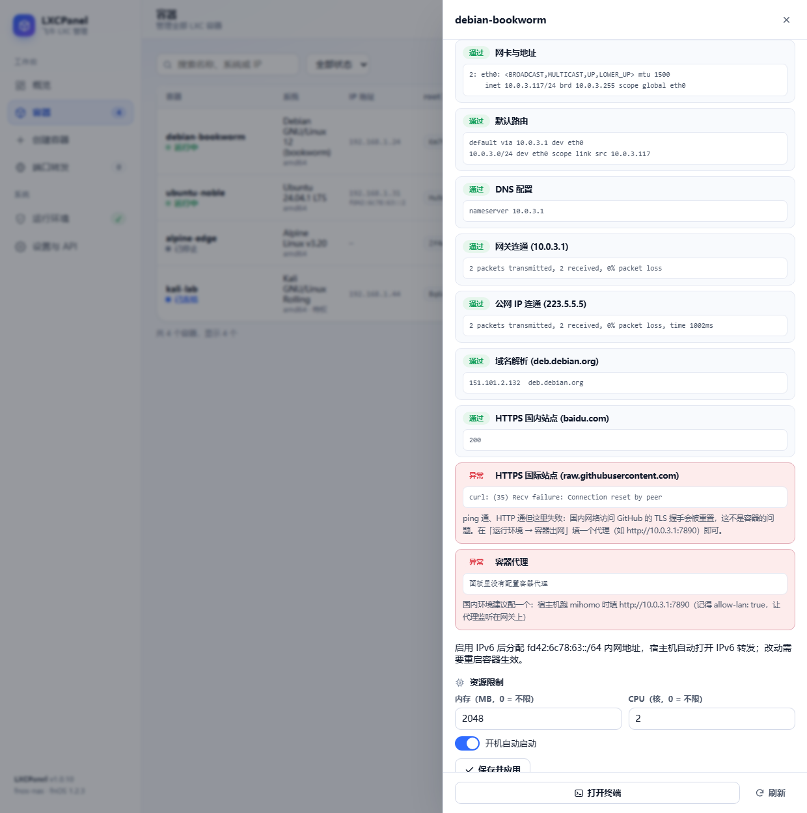

# lxc-fpk-panel · 飞牛 fnOS LXC 容器管理面板

[](LICENSE)
[](src/go.mod)
[](src/go.mod)
[](https://www.fnnas.com/)
[](LXCPanel/manifest)

> 面向 [飞牛 fnOS](https://www.fnnas.com/) 的原生 LXC 管理应用：以 `.fpk` 安装包分发，**内嵌在飞牛桌面窗口内运行**（不弹新标签页），提供容器全生命周期管理、发行版模板创建、浏览器终端、实时资源曲线，以及**完整的 REST API** 供脚本与自动化调用。

<sub>A native LXC management panel for fnOS (Feiniu NAS). Shipped as an `.fpk` and embedded in the fnOS desktop window. Go stdlib backend with **zero third-party Go dependencies**, REST API, MIT licensed.</sub>



**快速跳转**：[功能](#功能) · [截图](#截图) · [安装](#安装) · [从源码构建](#从源码构建) · [API](#api) · [技术栈与第三方项目](#技术栈与第三方项目) · [许可证](#许可证) · [故障排查](#故障排查)

## 功能

| 模块 | 能力 |
| --- | --- |
| 概览 | 主机 CPU / 内存 / 存储、容器数量分布、整机资源趋势曲线（最近 1 小时）、运行中容器速览 |
| 容器 | 列表、搜索、状态筛选、启动 / 停止 / 重启 / 冻结 / 解冻、删除、开机自启、资源上限（内存 / CPU）热调整 |
| 创建 | 10 个发行版模板（官方 LOGO）、版本选择（版本号 + 代号，如 `12 (bookworm)`）、国内镜像源（清华 / 中科大 / 阿里云 / 南大）、内存与 CPU 上限、**磁盘容量（不限制 / 指定 GB）**、创建后自动启动、创建日志实时流 |
| 终端 | 基于 PTY 的浏览器终端（xterm.js），`lxc-attach` 直连容器，支持窗口自适应与多会话 |
| 运行环境 | LXC 命令、download 模板、cgroup v2、容器目录、缓存目录、root 权限、wget/tar/xz 依赖自检，缺依赖可一键安装（apt/dnf/apk） |
| 存储 | 容器目录默认 `/var/lib/lxc`、镜像缓存默认 `/var/cache/lxc`，两者都可改到数据盘；迁移容器时同步改写 `lxc.rootfs.path` 与 `/etc/lxc/lxc.conf` 的 `lxc.lxcpath` |
| 磁盘 | 创建时可选「不限制」（dir，与宿主机共用分区）或指定容量（loop + ext4 镜像）；已有容器可随时转换 / 扩容，填 0 取消限制 |
| 网络 | 创建时可选 NAT 桥接（veth → lxcbr0）或「无网络」；容器可一键启用内网 IPv6（`fd42:6c78:63::/64`），宿主机侧自动打开 IPv6 转发并给桥接配上 `::1` 网关 |
| 出网自检 | 宿主机侧桥接 / `ip_forward` / NAT MASQUERADE / FORWARD 放行 / DHCP 逐项体检，出口 MTU 偏小时自动钳制 MSS，**一键修复**；容器内网络诊断覆盖网卡、路由、DNS、网关、公网、域名解析，以及 **HTTPS 国内 / 国际双探测**，直接区分「整条网络不通」和「站点被重置」 |
| 出网代理 | 给容器配 HTTP / SOCKS 代理（典型值 `http://10.0.3.1:7890`，直指宿主机上的 mihomo / clash），写进 `/etc/environment`、apt、`profile.d`、`bashrc`，新建与启动的容器自动带上，也可一键下发到所有运行中的容器 |
| 登录密码 | 创建容器时**自动生成随机 root 密码**并写进容器，列表直接可见、一键复制；改密后**回读 `/etc/shadow` 校验**，没写进去直接报错 |
| 登录就绪 | 「检查登录」逐项核对 root 密码哈希 / 账号锁定 / 登录 shell / sshd 安装与运行 / `PermitRootLogin` / `PasswordAuthentication`，红色项写明原因；「一键修好登录」自动改 shell、解锁、写 sshd 配置并启动，缺 `openssh-server` 可一键安装 |
| 端口转发 | 宿主机端口 → 容器服务（iptables DNAT，自建链 `LXCPANEL`），**IPv4 与 IPv6 双栈同时生效**，覆盖宿主所有地址与宿主机本机访问；规则持久化，容器启动 / 面板启动 / 手动刷新时按容器当前 IP 重建；每条规则可一键做**分层连通性检测**（容器直连 → 本机回环 → 各网卡地址） |
| 账户 | 安装时设置管理密码（PBKDF2 哈希存储）、登录状态保留 30 天、面板内改密 / 退出登录 |
| 设置 / API | API Token 管理、内网免密与局域网访问开关、默认镜像源、采样间隔、接口清单与 curl 示例 |

界面同时提供浅色与深色主题（跟随系统，可手动切换）。

## 截图

| 容器列表 | 创建向导 |
| --- | --- |
|  |  |

| 端口转发与分层探测 | 登录条件检查 |
| --- | --- |
|  |  |

## 安装

1. 下载 Releases 中的 `LXCPanel.fpk`；
2. 飞牛「应用中心 → 手动安装」上传该文件（需要管理员账号）；
3. **安装向导中设置管理密码**（至少 6 位），并选择「同一局域网内免密码登录」；密码以 PBKDF2-HMAC-SHA256 哈希保存在 `/vol{n}/@appdata/LXCPanel/admin.json`；
4. 首次启动后，桌面出现「LXC 容器」图标，点击即在飞牛窗口内打开面板；
5. 若设备尚未安装 LXC，进入「运行环境」页点击「安装 LXC 运行环境」（执行 `apt-get install lxc lxc-templates`），完成后即可创建容器。

> 安装位置默认由用户选择存储空间；应用数据落在 `/vol{n}/@appdata/LXCPanel`。

## 容器存放在哪里

容器的根文件系统**不在应用安装目录**里，默认由系统 LXC 管理：

| 内容 | 位置 |
| --- | --- |
| 容器本体（`config` + `rootfs/`） | `/var/lib/lxc/<容器名>/` |
| 面板数据（密码哈希、Token、任务日志、容器元信息） | `/vol{n}/@appdata/LXCPanel` |
| 镜像下载缓存（`lxc-download`） | `/var/cache/lxc`（可在面板内改到数据盘） |
| LXC 运行日志 | `/var/log/lxc` |

因此**卸载或重装 LXCPanel 都不会删除容器**，重装后打开面板即可看到原有容器（面板内的发行版备注会丢，`rootfs` 完好）；反过来，卸载也不会释放容器占用的磁盘空间，需要先删容器。

系统盘较小的设备（eMMC / 小容量 SSD）容易被多个 rootfs 占满。此时在「设置 → 容器存储位置」把目录改到数据盘（例如 `/vol1/lxc`）：

- **迁移并切换**：搬移已有容器 → 改写每个容器 `config` 里的 `lxc.rootfs.path`（不改正则容器起不来）→ 同步 `/etc/lxc/lxc.conf` 的 `lxc.lxcpath`（保证系统开机自启仍能识别）→ 删除旧位置副本；任一步失败会回滚。
- 迁移要求所有容器处于 **STOPPED**；跨分区时会先检查目标分区可用空间。
- **仅切换路径**：只改面板指向、不动文件，适用于你已经在 SSH 里手动搬过目录的情况；切换后旧目录里的容器不再显示（把路径改回即可恢复）。
- 面板此后所有 `lxc-*` 调用都会带上 `--lxcpath=<新目录>`。

### 模板缓存位置

`lxc-create -t download` 会把下载好的 rootfs / meta 压缩包缓存下来，默认在 `/var/cache/lxc`（同样属于系统盘），路径为 `<缓存目录>/download/<发行版>/<版本>/<架构>/<variant>`。面板在「设置 → 模板缓存位置」提供与容器目录相同的三种操作（迁移并切换 / 仅切换路径 / 恢复默认）：

- 切换后，创建容器时会以 `LXC_CACHE_PATH=<新目录>` 环境变量调用 `lxc-create`，新下载的镜像写入新位置；
- 缓存迁移不影响运行中的容器，也不需要停容器；迁移完成后旧缓存会被清掉，避免同一份镜像占两遍空间；
- 缓存可以随时删除（`rm -rf <缓存目录>/download`），只是下次创建同类容器要重新下载。

### 磁盘容量

容器的根分区默认与宿主机共用同一分区，所以**没有上限**，一个大日志或几个大文件就能把系统盘吃满。需要独立配额时，面板用 LXC 的 loop 存储后端给容器一块单独的 ext4 镜像：

| 选项 | 实际形态 | 说明 |
| --- | --- | --- |
| 不限制 | `rootfs/` 目录 | 与宿主机共用分区，容量随宿主盘变化 |
| 指定 N GB | `<容器目录>/rootdev` 镜像 | `lxc.rootfs.path = loop:.../rootdev`，容器内 `df` 看到的根分区就是 N GB |

- 创建容器时在「磁盘容量」里选择，走 `lxc-create -B loop --fstype ext4 --fssize NG`；
- 已有容器可在详情抽屉「磁盘容量」里调整，**需要先停止容器**：
  - 目录 → 指定容量：新建镜像、`mkfs.ext4`、把 rootfs 复制进去、校验后改写 `lxc.rootfs.path`，失败自动回滚；
  - 镜像扩容：`truncate` 扩镜像 + `e2fsck -f` + `resize2fs`，只支持变大（缩小需要重建文件系统，面板直接拒绝）；
  - 指定容量 → 0：把镜像内容复制回目录、删镜像、改回 `dir:`，恢复为不限制。
- loop 模式依赖内核 loop 设备（`/dev/loop-control`）与 `mount`，不支持时创建向导会禁用「指定容量」并提示；
- 本功能与容器迁移兼容：迁移到新目录时循环镜像的 `loop:` 绝对路径会一起改写。

## 端口转发与 IPv6

### 端口转发

左侧「端口转发」页把宿主机（飞牛）端口映射到容器里的服务，例如 `8080 → ubuntu-noble:80`，
局域网用 `http://<飞牛IP>:8080`、公网用 `http://<公网IP>:8080`、宿主机本机用 `http://127.0.0.1:8080` 都能访问。

实现是内核 DNAT，规则放在自建的链里，IPv4 和 IPv6 **各一套、同时生效**：

```
# IPv4（iptables）
nat    PREROUTING -j LXCPANEL       LXCPANEL      -m addrtype --dst-type LOCAL -p tcp --dport 8080 -j DNAT --to-destination 10.0.3.5:80
nat    OUTPUT     -j LXCPANEL-OUT   LXCPANEL-OUT  （同上，给宿主机自己访问用）
filter FORWARD    -j LXCPANEL       LXCPANEL      -p tcp -d 10.0.3.5 --dport 80 -m conntrack --ctstate NEW,ESTABLISHED -j ACCEPT

# IPv6（ip6tables），容器有非 fe80:: 的 IPv6 地址时自动生成
nat    PREROUTING -j LXCPANEL       LXCPANEL      -m addrtype --dst-type LOCAL -p tcp --dport 8080 -j DNAT --to-destination [fd42:6c78:63::5]:80
```

几个设计上的关键点，也是「配了却连不上」的常见原因：

| 做法 | 为什么 |
| --- | --- |
| DNAT 不写 `-d`，改用 `-m addrtype --dst-type LOCAL` | 只要目标是宿主机上的**任意**地址就命中：`0.0.0.0` 意义上的全部 IPv4、局域网 IP、公网 IPv4，以及宿主所有 IPv6（公网 / ULA / 临时地址）。写死某个地址就只从一个地址进 |
| 额外挂 `nat/OUTPUT`（`LXCPANEL-OUT`） | 宿主机自己访问 `127.0.0.1:8080` 或宿主 IP:8080 走的是 OUTPUT 链，不经过 PREROUTING。少了这条，本机测永远连不上 |
| 补 NAT 回环（hairpin） | DNAT 后容器回包的源是自己的地址，客户端发现不是它连的那台主机会丢弃，表现就是「请求到了容器，但浏览器一直转圈」 |
| 链每次同步都顶到 parent 第 1 行 | Docker 重启会把自己插到 FORWARD 最前面，它前面的 DROP 会把转发吃掉 |
| 容器有 IPv6 就一并生成 v6 规则 | 双栈机器从 IPv6 进来时走 `ip6tables` 的 PREROUTING，只有 v4 规则等于没配 |
| 补 `ip6tables POSTROUTING MASQUERADE` | 容器只有 `fd42::/64` 私有地址，不做源改写，回包发给公网 IPv6 客户端回不去 |

每次同步都是「清空自建链 → 按当前容器 IP 重填」，因此容器 DHCP 换 IP 后不用手工改规则。
触发时机：新增 / 删除规则、容器启动或重启、面板启动约 3 秒后、页面上的「重新应用全部规则」。

**连不上怎么查**：规则列表每行右边的 ✓ 按钮会从宿主机逐层探测，直接指出断在哪一层——

| 探测项 | 通了说明 | 不通说明 |
| --- | --- | --- |
| 宿主机 → 容器 `IP:端口` | 服务确实在听 | 容器里的服务没起来，或只监听了 `127.0.0.1` |
| 宿主机 → `127.0.0.1:宿主端口` | DNAT + OUTPUT 链 + 回环正常 | 规则没生效，点「重新应用全部规则」 |
| 宿主机 → 各网卡地址:宿主端口 | 外部客户端走的就是这条路，通常意味着外部也能进 | 防火墙上 FORWARD 被拦，或地址不是客户端用的那个 |

规则列表的「状态」列也会实时显示容器端口是否在听（`服务在听` / `服务未监听`），
把「转发没配好」和「服务没起来」两类问题分开。




几个注意点：

- **宿主端口不能已被占用**：DNAT 在 PREROUTING 生效，会把发往宿主机该端口的流量一并劫走，所以添加时会先查 `ss -ltn/-lun`，占用就直接拒绝；
- 规则存在 `${TRIG_PKGVAR}/portmap.json`，但 iptables 规则本身不跨重启：**飞牛重启后需要面板启动一次才会重建**（面板随系统启动则无感）；
- 容器没运行时不建规则，页面状态会标成「容器未运行」；容器起来后自动补上；
- UDP 只做转发不做探测（`UDP 无法探测`），验证请在容器里用 `nc -lup` + `nc -u` 对试；
- 只有 Linux 侧的 `iptables` 兼容层可用时才生效；宿主机是纯 nftables 且没有 `iptables`，页面会直接提示「缺少 iptables」。

### 容器 IPv6

默认模板只配了 IPv4，所以容器列表里 IPv6 一栏是空的。面板提供一套不依赖上游的私有方案：容器详情 → 网络 → 「启用内网 IPv6」，会自动做四件事：

1. 打开宿主机 `net.ipv6.conf.all.forwarding`（顺带 `net.ipv4.ip_forward`）；
2. 给桥接（默认 `lxcbr0`）加 `fd42:6c78:63::1/64` 当网关；
3. 给容器分配 `fd42:6c78:63::2` 起的空闲地址（写进 `lxc.net.0.ipv6.address` 与 `lxc.net.0.ipv6.gateway`）；
4. 之后可以在容器里 `ping6 fd42:6c78:63::1` 验证，或给 IPv6 地址做端口转发。

地址改在 config 里，**必须重启容器生效**（面板会提示）。这是 ULA 私有地址，只在宿主机与容器之间通；要让局域网用 IPv6 访问，需要路由器下发公网/内网前缀，拿到之后把容器的 `lxc.net.0.ipv6.address` 改成上游前缀内的地址即可。

创建向导里也能直接选：网络 = `NAT 桥接` / `无网络`，IPv6 = `不启用` / `启用（自动分配）`。

## 容器没有外网怎么办

容器里 `ping 8.8.8.8` 不通，几乎都出在宿主机侧。容器要出网依赖四件事，缺一件就断：

| 层级 | 检查 | 断掉的表现 |
| --- | --- | --- |
| 桥接 | `ip addr show lxcbr0` 有 `10.0.3.1/24` 且 `UP` | 容器网卡没有地址 |
| 转发 | `sysctl net.ipv4.ip_forward` = 1 | 网关能通，公网不通 |
| NAT | `iptables -t nat -S POSTROUTING` 有 `MASQUERADE` | 网关能通，公网不通 |
| DHCP/DNS | 桥接上 `:67` 有 dnsmasq 在听 | 容器拿不到 IP，`resolv.conf` 是空的 |

这三类问题 1.0.10 起由面板自动兜住：

1. **开机自愈**：面板启动 3 秒后自检一次，缺什么补什么；
2. **创建 / 启动前**：`lxc-create` 完成、`lxc-start` 之前都会跑一次同样的检查与修复；
3. **手动修**：「运行环境 → 容器出网」列出五项状态和一个「一键修复」按钮；容器详情 → 网络 → 「网络诊断」会在容器里跑 `ip addr` / `ip route` / `resolv.conf` / `ping 网关` / `ping 223.5.5.5` / `getent hosts`，直接告诉你断在哪一步；同一处的「一键修复出网」修宿主机侧。

修复动作都是幂等的标准配置，和 `lxc-net` 服务做的事一样：

```bash
ip link add lxcbr0 type bridge && ip addr add 10.0.3.1/24 dev lxcbr0 && ip link set lxcbr0 up
sysctl -w net.ipv4.ip_forward=1
iptables -t nat -A POSTROUTING -s 10.0.3.0/24 ! -d 10.0.3.0/24 -j MASQUERADE
iptables -I FORWARD -i lxcbr0 -j ACCEPT && iptables -I FORWARD -o lxcbr0 -j ACCEPT
```

DHCP / DNS 优先用系统自带的 `lxc-net` 服务（`systemctl start lxc-net`）；服务不存在或起不来时，面板会用自己的 `dnsmasq` 配置（写在应用数据目录 `lxc-dnsmasq.conf`，地址池 `10.0.3.100-240`，上游 DNS `223.5.5.5` / `119.29.29.29`）。如果宿主机**没装 dnsmasq**，修复会退化为给容器写静态 IP（`10.0.3.150` 起）+ 补 `resolv.conf`，同样能出网，只是不再自动分配地址。

> 注意：改的是容器 `config` 里的地址或宿主机侧刚补上的 DHCP，**已在运行的容器重启一次**才会拿到新地址。

## 能 ping 通，但 `curl https://…` 报错怎么办

这是另一类问题，和上面「完全没网」不是一回事。典型现场：

```text
root@lxc-debian-ujo:/# ping bing.com
64 bytes from 150.171.27.10: icmp_seq=1 ttl=45 time=70.6 ms      ← ICMP 通
root@lxc-debian-ujo:/# apt install wget
Get:1 http://deb.debian.org/debian bookworm/main amd64 wget ...  ← HTTP 通，还下了 937 kB
root@lxc-debian-ujo:/# curl -L https://raw.githubusercontent.com/…
curl: (35) Recv failure: Connection reset by peer               ← HTTPS 断
root@lxc-debian-ujo:/# wget https://raw.githubusercontent.com/…
GnuTLS: Error in the pull function.                              ← 同一个地方
```

`ping` 通、`apt` 也通，说明桥接、转发、NAT、DNS 全都是好的。断在 TLS 握手，只有两种原因：



**1）国际站点被阻断（最常见）**

`raw.githubusercontent.com`、`github.com`、部分 Cloudflare 站点在国内会在 TLS 握手阶段被 RST。
诊断里「HTTPS 国内站点」通过、「HTTPS 国际站点」失败，就是这个。解法是给容器配代理：

> 宿主机上跑 mihomo / clash 时，把它的 HTTP 端口开到网关上（`allow-lan: true`，`bind-address: '*'`），
> 然后在面板「运行环境 → 容器出网 → 容器出网代理」填 `http://10.0.3.1:7890` 点「保存并应用」。
> `10.0.3.1` 就是 `lxcbr0` 的网关地址，容器天然能访问到宿主机。

面板会把代理写进容器的这四个位置，覆盖 ssh 登录、systemd 服务、登录 shell（面板「终端」走的
`lxc-attach + shell -l` 就是这一类）和交互式 shell：

| 文件 | 谁读它 |
| --- | --- |
| `/etc/environment` | sshd / PAM、systemd 服务 |
| `/etc/apt/apt.conf.d/99lxcpanel-proxy` | `apt` / `apt-get`（apt 不读环境变量，必须单独写） |
| `/etc/profile.d/lxcpanel-proxy.sh` | 登录 shell |
| `/etc/bash.bashrc`、`/root/.bashrc` | 交互式 shell |

`no_proxy` 里排除了 `10.0.0.0/8` / `172.16.0.0/12` / `192.168.0.0/16`，宿主机与内网仍然直连。
清空输入框保存即可关闭代理，四个位置会同步删干净。

**2）上行 MTU 偏小导致的 MSS 黑洞**

宿主机如果是 PPPoE 拨号（MTU 1492）或跑了 WireGuard（1420），服务器的 TLS 证书包往往超过
实际路径 MTU 被丢弃，而 ICMP 的「需要分片」通告又被防火墙吃掉 —— 表现同样是 ping 通、https 卡死。
这种情况面板会在「容器出网」里多出一项 **MSS 钳制**，点「一键修复」后按出口 MTU 写死
`TCPMSS --set-mss <MTU-40>`（出口 MTU 是 1500 时则用 `--clamp-mss-to-pmtu`），入向出向各一条。

### 手上这台容器急着装东西，等不及升级怎么办

先确认宿主机有没有现成的代理端口：

```bash
ss -lntp | grep -E ':(7890|7891|1080|20171|20172)'
```

有的话，把监听地址改成 `0.0.0.0`（mihomo：`allow-lan: true`），然后在容器里直接指定：

```bash
export https_proxy=http://10.0.3.1:7890 http_proxy=http://10.0.3.1:7890
curl -I https://raw.githubusercontent.com        # 应该返回 301
```

没有代理时，尽量走国内可达的 CDN。以安装哪吒监控 Agent 为例：

```bash
# 脚本本身从 jsDelivr 取（国内可用），脚本会自己检测出口是否在中国大陆，
# 是的话改用 gitee.com 的镜像下载二进制
curl -fsSL https://cdn.jsdelivr.net/gh/nezhahq/scripts@main/agent/install.sh -o agent.sh
# jsDelivr 被污染时换这几个域名依次试：
#   https://fastly.jsdelivr.net/gh/nezhahq/scripts@main/agent/install.sh
#   https://gcore.jsdelivr.net/gh/nezhahq/scripts@main/agent/install.sh
#   https://testingcf.jsdelivr.net/gh/nezhahq/scripts@main/agent/install.sh
chmod +x agent.sh
env NZ_SERVER=nezha.luoxiyun.top:48008 NZ_TLS=false NZ_CLIENT_SECRET=<你的密钥> ./agent.sh
```

脚本硬编码了下载地址（没有覆盖用的环境变量），所以上面的 `NZ_*` 只影响注册参数，不影响下载源；
它靠访问 Cloudflare 的 `cdn-cgi/trace` 判断地理位置，国内会自动落到 gitee。gitee 偶尔抽风时重跑一次即可。

## 目录结构

```
lxc-fpk-panel/
├── LXCPanel/                # fpk 项目（fnpack 打包目录）
│   ├── app/
│   │   ├── server/          # 交叉编译的 linux 二进制（amd64 / arm64）
│   │   ├── ui/              # 桌面入口配置与图标（type=iframe）
│   │   └── www/             # 前端静态资源（面板启动时优先读磁盘，便于热改）
│   ├── cmd/                 # 生命周期脚本（install / upgrade / uninstall / config / main）
│   ├── config/              # privilege（run-as=root）、resource
│   ├── wizard/
│   └── manifest
├── src/                     # Go 后端 + 前端源码
│   ├── main.go              # 启动、路由、鉴权中间件、鉴权页
│   ├── api.go               # REST 接口
│   ├── lxc.go               # lxc 命令封装、配置解析、环境探测
│   ├── stats.go             # 采样与历史曲线
│   ├── term.go / pty_linux.go  # PTY 终端会话
│   ├── tasks.go             # 异步任务（创建/删除/安装）与 SSE 日志
│   └── www/                 # index.html / app.css / app.js / vendor(xterm)
├── tools/
│   ├── build.sh             # 交叉编译 + 同步前端 + 打包 + 权限修正
│   ├── fix_fpk_modes.py     # 修正 Windows 打包丢失的可执行位
│   ├── gen_icon.py          # 纯代码生成应用图标
│   ├── shot.js              # CDP 驱动 Edge 截图（等条件 / 点按钮 / 截全页）
│   └── mock_server.py       # 本地界面预览用的 Mock API
├── docs/API.md              # API 参考
└── docs/screenshots/
```

## 从源码构建

> **仓库里没有预编译产物**：`LXCPanel/app/server/lxcpanel-*` 与 `*.fpk` 都被 [.gitignore](.gitignore) 排除，
> 克隆后需要自己编译一次。只想安装的话直接用 [Releases](/releases) 里的 `LXCPanel.fpk`，不用构建。

需要 Go 1.21+（`tools/build.sh` 会优先使用 `tools/go/bin/go`，没有则用 PATH 里的 `go`）与 `fnpack`（仓库根目录已带 `fnpack.exe`）。

```bash
git clone https://github.com/yuanbi/lxc-fpk-panel.git
cd lxc-fpk-panel
bash tools/build.sh            # 交叉编译 amd64 + arm64 → 打包 → 修正权限
# 产物：LXCPanel/LXCPanel.fpk
```

构建流程：

1. `GOOS=linux` 交叉编译 `amd64` 与 `arm64` 两个静态二进制（`CGO_ENABLED=0`，无运行时依赖）；
2. 把 `src/www` 同步到 `LXCPanel/app/www`（前端同时被 `embed` 进二进制，磁盘副本优先）；
3. 调用 `fnpack build` 生成 fpk；
4. `tools/fix_fpk_modes.py` 修正包内权限位（Windows 上打包会丢失 `0755`，导致 `cmd/*` 与 `server/*` 不可执行），并同步 manifest 里的 `checksum`（必须等于 `app.tgz` 的 MD5，否则安装校验失败）。

本地预览界面（不需要飞牛设备、不需要 LXC）：

```bash
python tools/mock_server.py 8899
# 浏览器打开 http://127.0.0.1:8899/#overview ，支持 ?theme=dark 与 #containers / #create 等深链
```

## 架构说明

```
飞牛桌面 (iframe)
      │  /app/LXCPanel/...（应用网关反代到 127.0.0.1:18080）
      ▼
Go 单二进制（root 运行）
      ├── 内嵌/磁盘前端资源
      ├── REST API + SSE（任务日志、终端输出）
      └── exec: lxc-ls / lxc-info / lxc-create / lxc-start / lxc-attach ...
              └── /var/lib/lxc/*（可在设置里改到 /vol{n}/lxc/*）
```

- **桌面内嵌**：`app/ui/config` 中 `"type": "iframe"` + `service_port`，点击图标在飞牛窗口内打开；
- **零依赖**：后端仅用 Go 标准库（PTY 通过 `ioctl` 直接操作 `/dev/ptmx`，终端流走 SSE），无 cgo、无第三方包；
- **鉴权**：管理密码（安装向导设置）+ 会话 Cookie；本机与飞牛网关请求直接放行，局域网按「内网免密」设置，其余来源必须登录；脚本调用使用 `X-API-Token`。

| 请求来源 | 判定方式 | 默认行为 |
| --- | --- | --- |
| 本机进程（含飞牛网关反代） | 回环地址、本机网卡地址、或 Unix Socket + 代理头 | 直接放行，无需 Token |
| 同一内网设备 | RFC1918 / CGNAT / IPv6 ULA | 「内网免 Token」开启时放行（默认开启） |
| 其它地址 | 公网 IP | 必须携带 Token，否则返回登录页 |

## 安全说明

- 面板需要以 **root** 运行（`config/privilege` 中 `run-as=root`），因为 `lxc-*` 命令必须提权；这是管理容器的物理前提，请在可信网络中使用。
- API Token 存放在 `${TRIM_PKGVAR}/config.json`（权限 0600），同时会同步一份到 `${TRIM_PKGVAR}/api_token.txt`，并写入 `info.log`——**忘记 Token 或无法进入面板时，SSH 执行 `sudo cat /vol1/@appdata/LXCPanel/api_token.txt` 即可取回**。
- 「内网免密登录」默认开启，保证飞牛窗口内点开即用；公网暴露或多人共用网络时建议在设置中关闭，改为每次输入管理密码。
- 管理密码以 PBKDF2-HMAC-SHA256（12 万次迭代）哈希保存，登录成功后签发 30 天会话 Cookie；连续 6 次输错会锁定来源 IP 5 分钟。
- 忘记密码：`sudo /vol{n}/@appcenter/LXCPanel/server/lxcpanel-amd64 -set-pass -data /vol{n}/@appdata/LXCPanel`，按提示输入新密码。
- 「允许局域网访问」关闭后，非本机请求返回 403（仅持 Token 的脚本仍可调用）。
- 容器内为独立命名空间，但**特权容器（privileged）会共享宿主机部分能力**，创建时请评估风险。

## 技术栈与第三方项目

> LXCPanel **不是 LXC 的分支或衍生版本**，而是一个图形前端：它以子进程方式调用系统上的 `lxc-*` 命令行工具，
> 读取容器目录里的 `config` 与 `/proc` 里的 cgroup 数据，不修改 LXC 源码，也不链接 LXC 的库。

### 本仓库自己实现的部分

| 层 | 实现方式 |
| --- | --- |
| 后端 | **Go 1.21+，只用标准库**——[`src/go.mod`](src/go.mod) 里没有任何 `require`，无 cgo、无第三方 Go 包。`CGO_ENABLED=0` 静态编译，单文件二进制直接跑 |
| Web 终端 | 不依赖 `creack/pty`，直接用 `ioctl` 操作 `/dev/ptmx` 与 `/dev/pts/N` 自建 PTY 会话，输出走 SSE（`src/pty_linux.go`、`src/term.go`） |
| 前端 | 原生 HTML / CSS / JavaScript（ES2020），**无框架、无构建步骤、无 CDN**，所有资源随包分发，离线可用 |
| 图标 | `tools/gen_icon.py` 纯代码生成 PNG，不依赖设计源文件 |
| 打包 | 飞牛官方 `fnpack` + 自写 [`tools/fix_fpk_modes.py`](tools/fix_fpk_modes.py)（Windows 打包会丢失可执行位，脚本重写 tar 权限并同步 manifest 的 checksum） |

### 随包分发的第三方组件

| 组件 | 版本 | 许可证 | 用途 | 位置 |
| --- | --- | --- | --- | --- |
| [xterm.js](https://github.com/xtermjs/xterm.js) | 5.3.0 | **MIT** | 浏览器终端渲染 | `src/www/vendor/xterm.js`、`xterm.css` |
| [xterm-addon-fit](https://github.com/xtermjs/xterm.js) | 0.8.0 | **MIT** | 终端尺寸自适应 | `src/www/vendor/addon-fit.js` |
| [Simple Icons](https://github.com/simple-icons/simple-icons) | 13 | **CC0-1.0** | 发行版品牌图形（Debian / Ubuntu / Alpine / Kali…） | 内联在 `src/www/app.js` 的 SVG path |

- xterm.js 的完整许可证文本见 [`src/www/vendor/LICENSE.xterm`](src/www/vendor/LICENSE.xterm)，版权归 The xterm.js authors、SourceLair、Christopher Jeffrey；
- Simple Icons 的图形本身以 CC0-1.0 释出，但**各发行版的名称与 LOGO 是其各自所有者的商标**，本项目仅用于标识对应系统，不代表任何官方背书；
- 全部第三方声明集中见 **[THIRD-PARTY-NOTICES.md](THIRD-PARTY-NOTICES.md)**。

### 宿主机运行时依赖（调用系统命令，**不随本仓库或 fpk 分发**）

| 组件 | 许可证 | 用途 | 缺失时的表现 |
| --- | --- | --- | --- |
| [LXC](https://linuxcontainers.org/lxc/) | LGPL-2.1+ | 容器运行时（`lxc-create` / `lxc-start` / `lxc-attach`…） | 「运行环境」页提供一键安装 |
| [iptables](https://www.netfilter.org/) / `ip6tables` | GPL-2.0 | 端口转发 DNAT、NAT、MSS 钳制 | 端口转发不可用，其余功能正常 |
| [dnsmasq](https://thekelleys.org.uk/dnsmasq/doc.html) | GPL-2.0 / GPL-3.0 | 给容器下发 DHCP 与 DNS | 自动退回静态 IP + 手写 `/etc/resolv.conf` |
| [systemd](https://systemd.io/) | LGPL-2.1+ | 服务托管、`lxc-net` | 退回自管 dnsmasq 或静态地址 |
| `wget` / `tar` / `xz` | GPL-3.0 / GPL-2.0 / 公有领域 | `lxc-download` 下载并解包模板 | 无法在线创建容器 |

### 容器镜像

创建容器时由 `lxc-download` 从 `images.linuxcontainers.org`（或清华 / 中科大 / 阿里云 / 南大镜像）下载，
**不随本仓库或 fpk 分发**，每个镜像遵循其自身发行版的许可证与服务条款。

## 许可证

本项目以 **MIT License** 发布，完整文本见 [LICENSE](LICENSE)：

```
MIT License

Copyright (c) 2026 yuanbi

Permission is hereby granted, free of charge, to any person obtaining a copy
of this software and associated documentation files (the "Software"), to deal
in the Software without restriction, including without limitation the rights
to use, copy, modify, merge, publish, distribute, sublicense, and/or sell
copies of the Software, and to permit persons to whom the Software is
furnished to do so, subject to the following conditions:

The above copyright notice and this permission notice shall be included in all
copies or substantial portions of the Software.

THE SOFTWARE IS PROVIDED "AS IS", WITHOUT WARRANTY OF ANY KIND, EXPRESS OR
IMPLIED, INCLUDING BUT NOT LIMITED TO THE WARRANTIES OF MERCHANTABILITY,
FITNESS FOR A PARTICULAR PURPOSE AND NONINFRINGEMENT. IN NO EVENT SHALL THE
AUTHORS OR COPYRIGHT HOLDERS BE LIABLE FOR ANY CLAIM, DAMAGES OR OTHER
LIABILITY, WHETHER IN AN ACTION OF CONTRACT, TORT OR OTHERWISE, ARISING FROM,
OUT OF OR IN CONNECTION WITH THE SOFTWARE OR THE USE OR OTHER DEALINGS IN THE
SOFTWARE.
```

简单说：**可以自由使用、修改、商用、再分发，只需保留版权声明与许可证文本，作者不承担任何担保责任。**

许可边界：

- MIT 只覆盖**本仓库的代码**；随包分发的 xterm.js 保留其原始 MIT 版权声明，Simple Icons 图形为 CC0-1.0；
- 宿主机上的 LXC（LGPL-2.1+）、iptables（GPL-2.0）等系统组件由用户自行安装，**不因本项目而改变许可证**，也不与本项目构成衍生作品；
- 各发行版 LOGO 与名称是其所有者的商标，仅用于识别容器系统。
- 逐项声明见 [THIRD-PARTY-NOTICES.md](THIRD-PARTY-NOTICES.md)。

## 已知限制

- 仅支持 Linux 宿主（飞牛 fnOS 即 Debian 系），Windows / macOS 无法运行后端；
- 容器磁盘占用（rootfs 大小）暂未统计，避免对大目录反复 `du`；loop 模式展示了容量上限，实际用量需进容器 `df -h` 查看；
- loop 镜像**只能扩容不能缩小**（缩小需重建文件系统），也不支持 LXC 的快照克隆；
- 备份恢复、快照克隆、网络与端口映射可视化属于后续版本规划；
- `lxc-download` 依赖 `wget`、`tar`、`xz`，缺失时会在「运行环境」页提示；
- 端口转发的 iptables 规则不跨重启（内核表会被清空），只有规则存档持久化，面板启动时会重建；面板没启动则转发不生效；
- 端口转发依赖 `iptables` / `ip6tables` 命令（含 nft 兼容层）。宿主机若被替换成纯 nftables 且没有兼容层，转发会不可用；
- IPv6 端口转发要求宿主机网卡本身有可路由的 IPv6 地址、容器启用了内网 IPv6；容器只有 `fd42::/64` 而宿主没有 IPv6 时，IPv6 规则虽生成但外部进不来；
- 容器 IPv6 是 `fd42:6c78:63::/64` 的 ULA 私有地址，只能在宿主机与容器之间用，不能直接暴露到局域网/公网。
- 出网自检依赖 `ip` / `iptables`；宿主机是纯 nftables 且没有 `iptables` 兼容层时，NAT 规则需要手工配置（面板会明确提示）；
- root 密码由面板托管并存放在 `${TRIG_PKGVAR}/meta/containers.json`（`600`），它只是「面板记住的密码」，改容器内密码请仍在面板里改，否则两边会不一致；
- 「一键修好登录」安装 `openssh-server` 需要容器能访问软件源（Debian 系用 `apt`，Alpine 用 `apk`，RHEL 系用 `dnf/yum`，SUSE 用 `zypper`）；容器没网时先修出网。修改 sshd 配置会重启 sshd，已建立的 SSH 会话不受影响。

## 故障排查

| 现象 | 处理 |
| --- | --- |
| 点左侧菜单后标题变了、内容还是上一页 | 已定位并修复于 1.0.3（空数组被序列化成 `null` 导致渲染中断）。升级后若仍出现，按 `Ctrl+F5` 强制刷新一次；1.0.3 起资源 URL 带版本号，之后不会再读到旧 JS。 |
| 升级后功能没变化 | 1.0.3 前的版本把静态资源缓存了 24 小时。升级到 1.0.3 后强制刷新一次即可，后续升级会自动生效。 |
| 打开图标显示「设置管理密码」 | 覆盖升级不走安装向导，属正常流程：在窗口内设一次密码即可（启动 2 小时内有效）；超时后按页面提示的命令行设置。 |
| 端口转发「已启用」但连不上 | 在规则列表点这一行的 ✓ 做分层检测。卡在「宿主机 → 容器」就是服务没起（或只监听 `127.0.0.1`）；卡在「127.0.0.1」就是 DNAT 没生效，点「重新应用全部规则」；全通过但外部仍不行，检查飞牛「安全」页的防火墙是否放行该端口。 |
| 端口转发只在某些地址上能用 | 1.0.12 起 DNAT 用 `addrtype --dst-type LOCAL`，宿主任意地址都能进；旧版本写死了部分条件。升级后点一次「重新应用全部规则」。 |
| 容器 `ping` 通、`apt` 能下，但 `curl https://…` 报 `Connection reset` / `GnuTLS` 错误 | TLS 握手被打断，不是网络没配好。看「运行环境 → 容器出网」里有没有 MSS 项标红；没有的话就是国际站点被阻断，给容器配代理（`http://10.0.3.1:7890`）。详见「能 ping 通，但 curl https://… 报错怎么办」。 |
| 容器 `ping 8.8.8.8` 不通 | 进「运行环境 → 容器出网」看哪一项红了，点「一键修复」；再看容器详情 → 网络 →「网络诊断」确认断在网关还是公网。刚修完需要重启容器才拿到新地址。 |
| 提示「环境需要处理」 | 进入「运行环境」→「安装 LXC 运行环境」，需要设备能访问软件源。 |
| 改了 root 密码还是登不上（SSH 提示 `Permission denied` / `Connection refused`） | **密码写进去了不等于能登录**，SSH 这条链路上任何一环不对都会失败。点容器详情 → root 密码 →「检查登录」，面板会在容器里逐项核对：root 密码哈希是否有效、账号是否被锁、登录 shell 是否是 `nologin`、`openssh-server` 是否安装、sshd 是否在监听、`PermitRootLogin` 与 `PasswordAuthentication` 是否允许密码登录。红色项就是原因，点「一键修好登录」自动补齐（缺 sshd 时会询问是否安装）。最常见的是 Debian/Ubuntu 模板默认 `PermitRootLogin prohibit-password`，root 只能密钥登录。参考：[login_check](docs/screenshots/login_check.png) / [login_ready](docs/screenshots/login_ready.png)。 |
| 改密码时提示「密码没有写进容器」 | 1.0.13 起写入后会回读 `/etc/shadow` 比对哈希，没变就报错，不再假成功。通常是容器 rootfs 只读、或镜像不用 shadow 认证（如部分精简镜像），可在容器里 `ls -l /etc/shadow` 确认。 |
| 改了存储位置后容器列表变空 | 「仅切换路径」不会移动文件。改回原目录，或在「设置 → 容器存储位置」点「恢复默认」并从旧目录迁移回来；容器数据本身不会因为切换路径而丢失。 |

## 更新日志

- **1.0.13**：修复**改完 root 密码还是登不上**。根因是「写密码」和「能登录」被当成了一件事：① `chpasswd` 只看退出码，遇到 rootfs 只读、镜像不走 shadow 时会「成功返回但没写进去」，面板照样提示成功；② 即使密码真写进了 `/etc/shadow`，LXC 官方模板默认不带 `openssh-server`（SSH 直接 `Connection refused`），Debian / Ubuntu 的 sshd 又默认 `PermitRootLogin prohibit-password`（root 只能密钥登录），有的镜像还把 root 的 shell 改成 `nologin` 或把账号锁成 `!` 开头——这几种情况下密码怎么改都登不上。现在改密后**回读 `/etc/shadow` 比对哈希**，没变直接报错并给出原因，写成了会显示用的算法（SHA-512 / yescrypt）。容器详情新增**检查登录**：逐项核对密码哈希、账号锁定、登录 shell、sshd 是否安装 / 在监听、`PermitRootLogin` 与 `PasswordAuthentication`，红色项写明具体原因并可直接「一键修好登录」——自动改回正常 shell、解锁 root、写入 `PermitRootLogin yes` / `PasswordAuthentication yes`（优先 drop-in，老版本走主配置并 `sshd -t` 校验、失败回滚）、生成 host key 并启动 sshd；缺 `openssh-server` 时询问后一键安装（apt / apk / dnf / yum / zypper）。改密成功后也会自动跑一次检查，把「写进去了但登不上」当场摊开。
- **1.0.12**：修复**端口转发连不上**。原来的 DNAT 条件是 `! -i lo -p tcp --dport N`，看起来覆盖了所有接口，实际有三处缺口：① 宿主机自己访问 `127.0.0.1:端口` 走 OUTPUT 链，PREROUTING 根本不经过，本机测永远失败；② 没有 NAT 回环，DNAT 之后容器回包的源是自己的地址，客户端会丢弃，表现是「请求到了容器但浏览器一直转圈」；③ 容器同时有 IPv4 和 IPv6 时只生成了 IPv4 规则，从 IPv6 进来直接没有规则命中。现在 DNAT 改用 `-m addrtype --dst-type LOCAL` 命中「目标是本机的任意地址」（等价于 `0.0.0.0` 加宿主所有 IPv6），补了 `nat/OUTPUT`（`LXCPANEL-OUT`）与两条 hairpin SNAT，IPv4 / IPv6 双栈同时生成规则，并补 `ip6tables POSTROUTING MASQUERADE` 让 ULA 容器能回包给公网 IPv6；转发链每次同步都核对位置、顶到 FORWARD 第一位，避免被 Docker 的 DROP 压住。配套新增：规则列表显示「服务在听 / 服务未监听」（宿主机直连容器端口探测），每行 ✓ 按钮做**分层连通性检测**（容器直连 → 127.0.0.1 → 各网卡地址），直接指出断在哪一层；端口转发页顶部列出宿主全部 IPv4 / IPv6 入口地址与端口，点击即复制。
- **1.0.11**：解决「**能 ping、`apt` 也能下，但 `curl https://…` 被 reset**」。这类问题不在容器网络配置上——桥接、转发、NAT、DNS 都是好的，断在 TLS 握手。两种成因分别处理：国际站点被阻断时，新增**容器出网代理**（面板里填 `http://10.0.3.1:7890` 直指宿主机 mihomo，写进 `/etc/environment`、apt、`profile.d`、`bashrc` 四处，新建与启动的容器自动带上，一键下发到所有运行中容器）；上行 MTU 偏小（PPPoE / VPN）导致 MSS 黑洞时，自动加 `TCPMSS` 钳制规则并在体检里单列一项。网络诊断同时升级：新增 **HTTPS 国内 / 国际双探测**与代理落点检查，能一眼分清「整条网络不通」和「某个站点被重置」，诊断结果也从一段纯文本改成按项着色的卡片。
- **1.0.10**：修复**容器没有外网**（`ping 8.8.8.8` 不通）。1.0.9 只处理了容器 config 里有没有网卡，没管宿主机侧——飞牛上 `lxc-net` 通常没启用，于是 `lxcbr0` 没人配地址、`ip_forward` 是 0、没有 `MASQUERADE`、也没有 DHCP，容器自然出不去。现在面板会自检并自动补齐这四件事（面板启动、创建容器、启动容器三个时机都会跑），新增「运行环境 → 容器出网」体检卡片与一键修复，容器详情新增「网络诊断」（在容器里查地址、路由、DNS、网关、公网、域名解析）与「一键修复出网」。没装 dnsmasq 时会退化成给容器写静态 IP + DNS，保证能出网。同时新增**随机 root 密码**：创建容器时自动生成 14 位随机密码写进容器、记在面板里，**列表直接显示并可一键复制**，详情里可随时改密或重新随机生成。
- **1.0.9**：新增**端口转发**（宿主机端口 → 容器服务，iptables DNAT + 自建链，规则持久化并在容器启动 / 面板启动时按当前 IP 重建）与**容器内网 IPv6**（一键分配 `fd42:6c78:63::/64`、给桥接配 `::1` 网关、打开宿主机 IPv6 转发，重启容器生效）。创建向导新增「网络 / IPv6」选项，可选「无网络」；容器详情新增网络小节（veth、MAC、IPv6 开关）。顺带：列表里容器 IPv6 地址、状态都能看到了。
- **1.0.8**：修复容器列表里**「系统」列空白、内存恒为 `0 B`、CPU 恒为 `0.0%`**。原因有两处：一是内存/CPU 原先只认 `lxc-info` 的 `Memory use` / `CPU use` 两行，而它在部分系统上找不到 cgroup 会直接给 0；二是系统名只从配置里的 `lxc.rootfs.path` 拼路径读 `/etc/os-release`，遇到 `loop:` / `overlay:` 这类带后端前缀的写法就落空。现在改为顺容器 init 进程的 `/proc/<pid>/cgroup` 直读 `memory.current` 与 `cpu.stat`；系统名先试配置路径、再试挂载点 `<容器目录>/rootfs`、再让容器自己 `cat /etc/os-release`，最后用创建时记录的信息兜底（显示成 `Debian 12 (bookworm)`）。同时容器详情新增「**诊断信息**」按钮，一键导出 `lxc-info` 原始输出、config、rootfs 候选目录与 cgroup 数据，读不出来的情况可以直接把这份报告发出来定位。
- **1.0.7**：创建页的发行版不再用「DE / UB」这类字母占位，改为**官方 LOGO**（Simple Icons 收录的品牌图形，铺在品牌色底板上）；版本按钮改为「版本号（代号）」，如 Debian 显示 `12 (bookworm)`、Ubuntu 显示 `24.04 (noble)`，一眼能看出新旧。容器详情页头部也按 `os-release` 匹配对应发行版标识（匹配不到才回退到名称首字母）。
- **1.0.6**：新增**模板缓存位置可配置**与**容器磁盘容量**。缓存默认在 `/var/cache/lxc`（系统盘），现在可在「设置 → 模板缓存位置」改到数据盘，支持迁移已有缓存，创建容器时通过 `LXC_CACHE_PATH` 生效。磁盘方面，创建向导新增「磁盘容量」：选「不限制」沿用 dir 存储（与宿主机共用分区），选数值则用 loop 后端创建独立 ext4 镜像（`lxc-create -B loop --fssize NG`）；已有容器在详情抽屉里可随时转换（目录↔镜像）或扩容，取消限制即填 0。容器列表 / 详情新增磁盘模式与容量展示，容器迁移到其它目录时 `loop:` 绝对路径也会一并改写。
- **1.0.5**：新增**容器存储位置可配置**——默认 `/var/lib/lxc` 落在系统根分区，系统盘小的设备很容易被 rootfs 占满；现在可在「设置 → 容器存储位置」改到数据盘（如 `/vol1/lxc`），面板会把已有容器迁移过去（跨分区走 `cp -a`，同分区用 `rename` 秒完成）、改写各容器 `config` 里的 `lxc.rootfs.path`、同步 `/etc/lxc/lxc.conf` 的 `lxc.lxcpath` 让开机自启继续生效，任一步失败自动回滚。此后所有 `lxc-*` 调用带 `--lxcpath`，环境自检与磁盘统计也跟随实际目录。
- **1.0.4**：修复概览空状态里「创建容器」按钮的加号图标被放大、错位（空状态的大图标样式 `.empty svg` 波及了按钮内的图标，现收窄为 `.empty > svg`）。
- **1.0.3**：修复**未安装 LXC 时「运行环境」页打不开**——后端把空切片序列化成 `null`，前端 `e.templates.length` 直接抛异常，渲染中断后页面停留在上一个视图（看起来像"点运行环境却显示概览"）。现在后端空数组一律输出 `[]`，前端所有数组访问都有兜底，渲染异常会显示明确的错误卡片而不是残留旧页面。同时修掉**升级后仍加载旧 JS** 的问题：`index.html` 不再缓存、资源 URL 带版本号（`app.js?v=1.0.3`）、其它资源改为 `no-cache` 强校验。
- **1.0.2**：改为**管理密码登录**，密码在安装向导中设置（PBKDF2 哈希存储）；登录后会话保留 30 天，面板内可改密与退出登录。相比 1.0.1 的 Token 登录，不再需要先去翻文件找 Token，安装完即可使用。
- **1.0.1**：修复内嵌窗口打不开面板的问题——飞牛网关转发的来源不是回环地址，旧版会把窗口拦在 Token 登录页，而 Token 又只能在面板内查看，形成死锁。现按来源分类放行（本机/网关直通、内网免 Token 可关），并把 Token 额外落盘到 `api_token.txt` 与 `info.log`，锁死后可 SSH 取回。
- **1.0.0**：首个版本。

## API

面板本身是一个完整的 REST 服务（默认 `18080` 端口），界面上的每个操作都有对应接口。完整字段与响应示例见 **[docs/API.md](docs/API.md)**，这里是速查表。

### 认证

三种方式，按来源自动判定：

| 方式 | 用法 | 适用 |
| --- | --- | --- |
| 会话 Cookie | `POST /api/auth/login` 登录后由浏览器携带，有效期 30 天 | 面板 UI |
| API Token | 请求头 `X-API-Token: <token>`，Token 在「设置 → API」查看或重置 | 脚本 / 自动化 |
| 免密直通 | 本机与飞牛网关来源默认放行，可在设置里开关「内网免密」 | 内嵌窗口 |

```bash
TOKEN=$(cat /vol1/@appdata/LXCPanel/api_token.txt)
curl -s -H "X-API-Token: $TOKEN" http://nas:18080/api/containers | jq
```

### 系统与环境

| 方法 | 路径 | 说明 |
| --- | --- | --- |
| `GET` | `/api/overview` | 首页数据：主机资源、容器列表、数量汇总、最近 1 小时曲线 |
| `GET` | `/api/system` | 主机明细：CPU 型号 / 核数、内存、存储、内核、运行时长 |
| `GET` | `/api/env` | LXC 运行环境自检：命令、download 模板、cgroup v2、容器目录、缓存目录、root 权限、wget/tar/xz |
| `POST` | `/api/env/install` | 安装缺失的 LXC 环境（异步任务，自动选 apt / dnf / apk） |
| `GET` | `/api/distros` | 可选发行版与版本、镜像源、当前架构 |
| `GET` | `/api/hostnet` | 宿主机出网体检：桥接 / 转发 / NAT / FORWARD / DHCP / MSS / 容器代理 |
| `POST` | `/api/hostnet` | 一键修复出网，请求体带 `proxy` 时同时下发容器代理 |
| `GET` | `/api/settings` | 面板设置（内网免密、默认镜像源、采样间隔、出网代理、存储位置） |
| `PUT` | `/api/settings` | 修改设置 |
| `POST` | `/api/storage/switch` | 切换容器目录 / 镜像缓存目录，可选是否迁移已有容器 |
| `POST` | `/api/token/rotate` | 重新生成 API Token（旧 Token 立即失效） |

### 容器

| 方法 | 路径 | 说明 |
| --- | --- | --- |
| `GET` | `/api/containers` | 容器列表（状态、IP、CPU / 内存、root 密码等） |
| `POST` | `/api/containers` | 创建容器（异步任务）：发行版、版本、镜像源、内存、CPU、磁盘、自动启动 |
| `GET` | `/api/containers/{name}` | 单个容器详情 |
| `DELETE` | `/api/containers/{name}` | 删除容器及其数据（异步任务） |
| `POST` | `/api/containers/{name}/action` | 生命周期操作，请求体 `action` 取 `start` / `stop` / `kill` / `restart` / `freeze` / `unfreeze` |
| `PUT` | `/api/containers/{name}/limits` | 内存上限、CPU 上限、开机自启（内存 / CPU 支持运行中热调整） |
| `POST` | `/api/containers/{name}/disk` | 磁盘容量：`0` 取消限制、指定 GB 扩容、dir ↔ loop 互转 |
| `POST` | `/api/containers/{name}/ipv6` | 启用 / 关闭内网 IPv6（`fd42:6c78:63::/64`） |
| `PUT` | `/api/containers/{name}/password` | 修改 root 密码，`{"random":true}` 重新随机生成；写入后回读 `/etc/shadow` 校验 |
| `GET` | `/api/containers/{name}/login` | 检查 SSH 登录条件（密码哈希 / 锁定 / shell / sshd / PermitRootLogin） |
| `POST` | `/api/containers/{name}/login` | 修复登录条件；`{"install":true}` 会安装 `openssh-server`（异步任务） |
| `GET` | `/api/containers/{name}/netdiag` | 容器内网络诊断：网卡、路由、DNS、网关、公网、HTTPS 国内 / 国际 |
| `POST` | `/api/containers/{name}/netfix` | 一键修复该容器出网并下发代理 |
| `GET` | `/api/containers/{name}/diag` | 导出完整诊断文本（贴 issue 用） |
| `GET` | `/api/containers/{name}/logs?lines=200` | 容器日志 |
| `GET` | `/api/containers/{name}/config` | 容器 `config` 原文 |
| `GET` | `/api/containers/{name}/stats` | CPU / 内存历史采样点 |

### 端口转发

| 方法 | 路径 | 说明 |
| --- | --- | --- |
| `GET` | `/api/portmap` | 规则列表 + 转发状态（出网链、NAT 回环、IPv6 可用性） |
| `POST` | `/api/portmap` | 新建规则：`container` / `proto` / `host_port` / `target_port` |
| `POST` | `/api/portmap/sync` | 按容器当前 IP 重新应用全部规则 |
| `POST` | `/api/portmap/{id}/probe` | 单条规则分层探测：容器直连 → 本机回环 → 各网卡地址 |
| `DELETE` | `/api/portmap/{id}` | 删除规则 |

### 终端

| 方法 | 路径 | 说明 |
| --- | --- | --- |
| `POST` | `/api/containers/{name}/terminal` | 创建 PTY 会话，返回 `{ "id": "s_xxx", "shell": "/bin/bash" }` |
| `GET` | `/api/term/{id}/stream` | SSE 输出流，`{"d":"<base64>"}`，结束事件 `event: end` |
| `POST` | `/api/term/{id}/input` | 发送按键 `{"d":"<base64>"}` |
| `POST` | `/api/term/{id}/resize` | `{"cols":120,"rows":32}` |
| `DELETE` | `/api/term/{id}` | 关闭会话（30 分钟无操作自动回收） |

### 异步任务

创建、删除、装环境、调磁盘、装 SSH 都是异步任务，返回 `{"task_id":"…"}`：

| 方法 | 路径 | 说明 |
| --- | --- | --- |
| `GET` | `/api/tasks` | 任务列表 |
| `GET` | `/api/tasks/{id}` | 任务状态与完整日志 |
| `GET` | `/api/tasks/{id}/stream` | SSE 实时日志，结束事件带 `status` 与 `error` |

### 示例

```bash
TOKEN=$(cat /vol1/@appdata/LXCPanel/api_token.txt)
API=http://nas:18080/api
H="X-API-Token: $TOKEN"

# 列出容器
curl -s -H "$H" $API/containers | jq '.containers[] | {name, state, ipv4}'

# 启动容器
curl -s -X POST -H "$H" -H 'Content-Type: application/json' \
     -d '{"action":"start"}' $API/containers/mybox/action

# 创建一个 2 核 2G、10GB 磁盘的 Debian 12
curl -s -X POST -H "$H" -H 'Content-Type: application/json' -d '{
  "name":"mybox", "distro":"debian", "release":"12",
  "memory_mb":2048, "cpus":2, "disk_gb":10, "autostart":true
}' $API/containers | jq -r .task_id | xargs -I{} curl -N -H "$H" $API/tasks/{}/stream

# 把宿主 8080 转发到容器 80
curl -s -X POST -H "$H" -H 'Content-Type: application/json' \
     -d '{"container":"mybox","proto":"tcp","host_port":8080,"target_port":80}' $API/portmap

# 改 root 密码并检查能不能登录
curl -s -X PUT -H "$H" -H 'Content-Type: application/json' \
     -d '{"password":"NewPass123"}' $API/containers/mybox/password | jq '.write'
curl -s -H "$H" $API/containers/mybox/login | jq '{ready, issues}'
```

## 致谢

感谢 [飞牛 fnOS 开发者文档](https://developer.fnnas.com/docs/guide/) 提供的 fpk 打包规范与内嵌窗口机制，
以及 [linuxcontainers.org](https://linuxcontainers.org/) 提供的 LXC 运行时与镜像模板。

